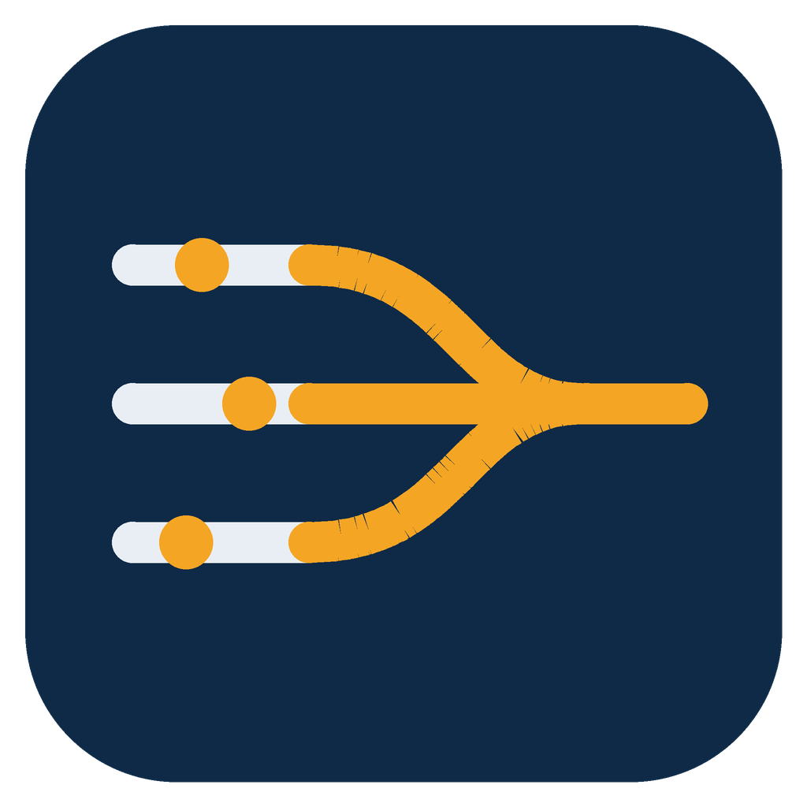

<p align="center">
  
</p>

# Syncyard

**Synchronized, gated dispatch to your own machines: self-hosted CPU/GPU runner lanes plus an API-budget gatekeeper for agent workflows.**

A marshalling yard sorts work onto parallel tracks so everything moves in order instead of colliding. Syncyard does that for a fleet of AI agents and automation programs running jobs on your own computers: independent CPU and GPU runners stay synchronized through one checkpoint, every job is counted against a shared API budget, and each job travels a lane sized for it.

## Why it exists

When several programs share one GitHub account and a few personal machines, two resources run out fast:

1. **The GitHub API budget.** The account-wide quota is 5,000 REST calls per hour. A morning of many programs dispatching and polling their own jobs at once can exhaust it — and when it is gone, every program stops, including the ones that behaved. (This happened on the founding deployment, on day one; the census is summarized in [docs/STANDARD.md](docs/STANDARD.md).)
2. **The runner queue.** A self-hosted runner executes one job at a time. On a single shared runner, a two-minute status probe can wait over an hour behind a long render.

Syncyard fixes the ordering and the spending, not the machines:

- A **gatekeeper** is the only door. Programs submit job requests to it; it checks API headroom before dispatching, refuses duplicates, assigns lanes, and watches every run in one batched sweep.
- **Lanes** split the runners by job shape, so quick checks never stand behind long renders.
- A written **fleet standard** covers poll discipline, lane routing, and job health checks — so the rules hold even for work submitted by hand.

## Architecture

```text
  programs / agents
        |  submit (job file + unique key)
        v
  +-------------+      rate-limit check, duplicate check,      +----------+
  |  GATEKEEPER |      lane assignment, one batched watcher    |  GitHub  |
  |   (gk.py)   | -------------------------------------------> |   API    |
  +-------------+      workflow_dispatch only                  +----------+
        ^                                                            |
        |  marker lines harvested from run logs                      | runs
        |  (verdicts come from markers, never the                  v
        |   green checkmark alone)                     +------------------------+
        +--------------------------------------------- |  RUNNER LANES          |
                                                       |  quick | normal |      |
                                                       |  long  | gpu           |
                                                       |  on your own machines  |
                                                       +------------------------+
```

Outside this flow, the operator keeps a separate, frozen emergency admin path for the rare case where the Actions route itself is the thing that is broken. It carries no job traffic; Syncyard is the only door for work.

## Security model

A public repository with self-hosted runners is a known hazard class: if untrusted code can trigger a workflow, it can run on your machines. Syncyard's design removes that trigger surface, and the rules below are load-bearing — pull requests that weaken them will not be merged.

- **Dispatch only.** The runner workflows (`run`, `wsl`, `grab`) bind self-hosted runners and are triggered **only** by `workflow_dispatch`. Dispatching a workflow requires write access to this repository, so only trusted collaborators can start a job.
- **Never** bind a self-hosted runner to `pull_request`, `pull_request_target`, `issues`, or any other event that untrusted users can cause. Not in this repository, not in a fork you deploy.
- **CI is hosted-only.** Continuous integration runs on GitHub-hosted runners and never touches the self-hosted fleet.
- **Repo-scoped registration.** Runners register to this repository only — never organization-wide — so the blast radius of any mistake is one repository.
- **No secrets in the repo.** No tokens, credentials, or registration material is committed. Registration tokens are short-lived, fetched at setup time, used once, and never stored (see [runner/SETUP.md](runner/SETUP.md)).

More detail, including how to report a vulnerability, is in [SECURITY.md](SECURITY.md).

## Quickstart

**1. Register a runner** on a Windows machine you own, signed in as the user the jobs should run as. Fetch a registration token (valid about an hour), then run the setup script once per lane:

```powershell
gh api -X POST repos/AXIOVEX/syncyard/actions/runners/registration-token --jq .token
.\runner\setup-runner.ps1 -Name "myhost-quick" -Labels "lane-quick" -RunnerDir "C:\actions-runner-quick" -RegistrationToken <token> -Start
```

The full owner-session runbook — all four lanes, the watchdog install, and the per-lane identity proof — is [runner/SETUP.md](runner/SETUP.md).

**2. Submit a job** through the gatekeeper from the operator machine:

```bash
python3 gatekeeper/gk.py submit --program myprogram --workflow run.yml \
    --lane quick --script ./probe.ps1 --cwd 'C:\Users\me' --key probe-2026-01-01
python3 gatekeeper/gk.py status
```

A scheduled `gk.py sweep` (every 5 minutes) dispatches within budget, watches all runs in one batched pass, and records the verdict markers each job prints. See [gatekeeper/README.md](gatekeeper/README.md).

## Lanes

Every dispatch declares a lane. No lane declared = not dispatched.

| Lane | Label | Expected duration | Carries |
|---|---|---|---|
| quick | `lane-quick` | under ~2 min | probes, status checks, small transfers |
| normal | `lane-normal` | ~2–30 min | builds, installs, packaging |
| long | `lane-long` | over ~30 min, or unknown | batch stages, scoring runs, renders |
| gpu | `lane-gpu` | any duration | any job that needs a GPU |

Routing rules: **a GPU need overrides duration** (a quick GPU probe still goes to `gpu`); **unknown duration goes to `long`**; a job that overruns its lane's norm twice is re-laned. The GPU lane is serial on purpose — GPU jobs never contend for memory. Lanes give queue isolation, not more compute: the machine's CPU, memory, and disk are still shared. Full rules in [docs/STANDARD.md](docs/STANDARD.md).

## Fleet discipline (summary)

- **One watcher per run**, polling no faster than every 3–5 minutes, batched reads over per-run calls.
- **Check headroom before bursts**: `gh api rate_limit` is free; below 1,000 core calls remaining, stand down to minimum cadence; below 500, completion-critical calls only.
- **A 403 rate-limit response is a hard stop.** Never retry through it; wait for the reset and a fresh headroom check.
- **Verdicts come from marker lines** the job prints in its own log — never from the Actions success color alone. Some platforms have shown run status lagging far behind the real result; the markers are the record.
- **Watermarks trigger checks, never automatic cancels.** A job that waits or runs too long gets a recorded check (starvation vs. stall), an escalation with evidence, and — only if truly stuck — cancellation by its own program's coordinator or the owner.

The full standard is [docs/STANDARD.md](docs/STANDARD.md).

## For agents

[SKILL.md](SKILL.md) is the operating skill for AI agents: the exact commands, lane routing, marker-verdict rule, API discipline, and escalation etiquette. An agent can pick this repository up cold from that file.

## Repository layout

| Path | What it holds |
|---|---|
| `gatekeeper/` | `gk.py`, the dispatch/watch gatekeeper, and its README |
| `runner/` | The dispatch workflows, runner setup script, runner watchdog, and the setup runbook |
| `clients/` | Convenience shell clients for interactive one-offs (gatekeeper submission is the preferred route) |
| `docs/` | The fleet standard and the migration/cutover plan |
| `assets/` | Logo |

## Versioning

Syncyard uses [Semantic Versioning](https://semver.org). Every change lands as a repository update with a version bump per semver and an entry in [CHANGELOG.md](CHANGELOG.md) (kept in [Keep a Changelog](https://keepachangelog.com) format). When behavior and the fleet disagree in the field, the fix lands here first, with a new revision — this repository is the canonical published source, and operator copies track its releases.

## License

Copyright © 2026 Axiovex Systems, LLC. All rights reserved. See [LICENSE](LICENSE).
