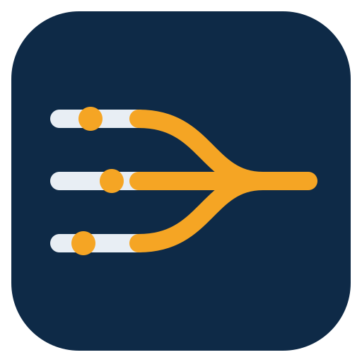

<p align="center">
  
</p>

# Syncyard

**Synchronized, gated dispatch to your own machines: self-hosted CPU/GPU runner lanes plus an API-budget gatekeeper for agent workflows.**

[](https://github.com/AXIOVEX/syncyard/actions/workflows/ci.yml)
[](https://github.com/AXIOVEX/syncyard/releases)

## The two-minute story

A marshalling yard sorts work onto parallel tracks so everything moves in order instead of colliding. Syncyard does that for a fleet of AI agents and automation programs running real work on the owner's own machines.

**The problem.** An agent fleet can *decide* work anywhere, but the work itself — renders, builds, bench runs, GPU jobs — has to happen on the owner's hardware: the desktop with the GPUs, the workstation with the lab gear attached. The obvious bridge is self-hosted GitHub Actions runners, and it fails two ways at once. First, the budget: several programs share one GitHub account with a 5,000-call hourly REST quota, and a morning of every program dispatching and polling its own jobs can exhaust it — when it is gone, every program stops, including the ones that behaved. (This happened on the founding deployment, on day one; the census is summarized in [docs/STANDARD.md](docs/STANDARD.md).) Second, the queue: a self-hosted runner executes one job at a time, so on a single shared runner a two-minute status probe can wait over an hour behind a long render. And underneath both sits a hazard: a self-hosted runner reachable by the wrong trigger is remote code execution on your own computer, gift-wrapped.

**The answer** is ordering and a gate, not more machines:

- A **gatekeeper** is the only door. Programs submit job requests to it; it checks API headroom before dispatching, refuses duplicates, assigns lanes, and watches every run in one batched sweep.
- **Lanes** split the runners by job shape, so quick checks never stand behind long renders.
- A written **fleet standard** covers poll discipline, lane routing, and job health checks — so the rules hold even for work submitted by hand.

### The scars that shaped the design

Syncyard's rules are not theory; each one is a repair:

- **Silent write corruption made the gatekeeper paranoid about its own records.** The host platform intermittently refused writes in waves and dropped buffered writes silently, leaving 0-byte queue files standing where records should be. So every gatekeeper write is written, read back, and verified byte-for-byte before it counts (spec 001 FR-012), and a record update lands only as an atomic swap of a fully verified file — a failed save can never destroy the standing record, and the gatekeeper never dispatches a job it could not record first (FR-013).
- **Run colors lied, so verdicts come from markers.** Platform run status has lagged far behind reality — a run can sit at "queued" long after its work finished, or show green for a job that failed inside. Every Syncyard job prints marker lines into its own log, and the gatekeeper harvests those as the verdict. A success color without markers is not a success.
- **A queue file destroyed at open taught the transport its shape.** Jobs travel as base64 scripts in workflow inputs, which have a hard size ceiling (about 54 KB in practice); oversize dispatches fail, so the config carries a transport ceiling and a chunked transport exists for payloads that outgrow it.
- **The dispatch-only invariant is the whole security model.** Self-hosted runners are reachable *only* through the gatekeeper's `workflow_dispatch` calls — never through pull requests, issues, or any event a stranger can cause. The full posture is [SECURITY.md](SECURITY.md).

### What Syncyard deliberately does not do

- **It does not prevent a shutdown.** Syncyard's shutdown story (spec 011, in design) is *delay + drain + checkpoint + notify, never prevent*: it can hold a polite shutdown long enough for running work to checkpoint, write a going-down record, and tell the operator — it cannot stop a forced shutdown, a power loss, or a held power button, and it will not pretend otherwise.
- **It does not fail over between hosts.** A job addressed to a lane runs on that lane's host or is refused — never silently rerouted to a different machine (spec 010 FR-004). If the host is down, the job waits or escalates; it does not land somewhere unexpected.
- **It is not a general CI system.** CI for this project runs on GitHub-hosted runners. Syncyard exists to run an owner's own work on an owner's own machines, under one person's rules — no multi-machine pooling, no runner autoscaling, no multi-tenancy.

## Architecture

```text
  programs / agents
        |  submit (job file + unique key)
        v
  +-------------+      rate-limit check, duplicate check,      +----------+
  |  GATEKEEPER |      lane assignment, one batched watcher    |  GitHub  |
  |   (gk.py)   | -------------------------------------------> |   API    |
  +-------------+      workflow_dispatch only                  +----------+
        ^                                                            |
        |  marker lines harvested from run logs                      | runs
        |  (verdicts come from markers, never the                  v
        |   green checkmark alone)                     +------------------------+
        +--------------------------------------------- |  RUNNER LANES          |
                                                       |  quick | normal |      |
                                                       |  long  | gpu           |
                                                       |  on your own machines  |
                                                       +------------------------+
```

Outside this flow, the operator keeps a separate, frozen emergency admin path for the rare case where the Actions route itself is the thing that is broken. It carries no job traffic; Syncyard is the only door for work.

## Security

The whole model fits in one sentence:

> Runners are reachable only via `workflow_dispatch` from the gatekeeper; no workflow may bind self-hosted labels to `pull_request`, `pull_request_target`, or issue events; the door repository is private; the backchannel repository is private.

Read **[SECURITY.md](SECURITY.md)** before you deploy anything: the posture in plain language, plus adopter checklists for token scoping and runner isolation. The short version: the dispatch workflows live in a private door repository, CI is GitHub-hosted only, runners register repo-scoped and run as a normal user, and pull requests that weaken any of this will not be merged.

## Quickstart

**1. Register a runner** on a machine you own, signed in as the user the jobs should run as — see the per-host quickstarts below for your platform. The pattern is the same everywhere: fetch a registration token (valid about an hour), run the setup once per lane, and prove the venue with its identity markers.

**2. Submit a job** through the gatekeeper from the operator machine:

```bash
python3 gatekeeper/gk.py submit --program myprogram --workflow run.yml \
    --lane quick --script ./probe.ps1 --cwd 'C:\Users\me' --key probe-2026-01-01
python3 gatekeeper/gk.py status
```

A scheduled `gk.py sweep` (every 5 minutes) dispatches within budget, watches all runs in one batched pass, and records the verdict markers each job prints. See [gatekeeper/README.md](gatekeeper/README.md).

Prefer the GitHub CLI? Syncyard ships as an extension: `gh extension install AXIOVEX/gh-syncyard`, then `gh syncyard status` drives the same gatekeeper.

### Windows host

- **Prerequisites:** a Windows machine signed in as the user jobs should run as; PowerShell; the `gh` CLI signed in with write access to your (private) door repository.
- **Door workflows:** `run.yml` executes a PowerShell script on the host; `grab.yml` returns a file from the host as an artifact. (`wsl.yml` also runs on this host's runner — it is the WSL2 transport below.)
- **Setup:** fetch a registration token, then run the setup script once per lane:

```powershell
gh api -X POST repos/<you>/<door-repo>/actions/runners/registration-token --jq .token
.\runner\setup-runner.ps1 -Name "myhost-quick" -Labels "lane-quick" -RunnerDir "C:\Users\<you>\Development\Syncyard\runners\quick" -RegistrationToken <token> -Start
```

The full owner-session runbook — all four lanes, the tray supervisor install, and the per-lane identity proof — is [runner/SETUP.md](runner/SETUP.md). Supervise the runners windowlessly with the Syncyard Tray: download `SyncyardTray-Setup-0.1.0.exe` from [Releases](https://github.com/AXIOVEX/syncyard/releases), run it (per-user, no admin), and the runners start hidden under a tray icon that shows per-lane state and restarts a dead runner.
- **How a job reaches it:** a job submitted with `--workflow run.yml` and a lane whose config host is this Windows machine dispatches to the runner carrying that lane's label. Identity markers: `LID_HOST`, `LID_WINUSER`, `LID_OS`.
- **Honest limits:** runners started by the tray start at logon, not at boot — a rebooted machine serves no jobs until its user signs in (closing that gap is spec 011's work, not a shipped feature). The runner process is not elevated; work that needs administrator rights is work the owner runs by hand from a prepared script.

### WSL2 (via a Windows host)

- **Prerequisites:** the Windows host above, with a WSL2 distro installed (the fleet standard is Ubuntu 24.04) and the runner for your lane running on the Windows side.
- **Door workflows:** `wsl.yml` — it runs on the Windows host's runner and hops into the host's default WSL2 distro, executing a base64 bash script with the distro as the venue. `grab.yml` returns files from the distro too; the path it takes is the file's UNC path through the Windows host (`\\wsl.localhost\<distro>\...`).
- **How a job reaches it:** config declares a `wsl2` host *via* its Windows host (see `config/syncyard.example.yaml`). A lane pointed at the wsl2 host routes `wsl.yml` jobs to the Windows runner, which enters the distro. Identity markers: `LID_HOST`, `LID_WSLUSER`, `LID_OS`.
- **Hard rule — never stage cross-job payloads in `/tmp`.** On WSL, `/tmp` does **not** persist between jobs: the distro instance stops when a job's session ends, and files one job staged in `/tmp` are silently gone when the next job looks for them (proven in the field, 2026-10-31 — a multi-part payload staged there vanished between the staging job and the install job, while both reported success). Stage anything a later job must read in the **WSL home directory** or the **job's working tree**, never in `/tmp`.
- **Honest limits:** a process a job detaches inside WSL does not reliably outlive the job's session — long-lived work belongs under a supervisor anchored outside the job (a scheduled task on the Windows side), not under `nohup`. Plain `nvidia-smi` has no NVML inside WSL2; call the Windows binary (`/mnt/c/Windows/System32/nvidia-smi.exe`) for GPU truth.

### Linux host

- **Prerequisites:** a Linux machine with bash and the runner agent's own requirements; `gh` CLI access for registration.
- **Door workflows:** `linux.yml` executes a base64 bash script natively (exit code propagates; `cwd` from the host's config map, empty means the runner user's home). `grab.yml` returns files.
- **How a job reaches it:** declare a `linux` host in config, point a lane at it, and register a runner on the machine carrying that lane's label. Identity markers: `LID_HOST`, `LID_USER`, `LID_OS`. The example config carries a commented Linux host + lane block to start from.
- **Honest limits:** `linux.yml` and `macos.yml` share one script body and the contract battery fails CI if they drift — behavior is identical on both, including the sharp edges. The transport is proven by a hosted-runner smoke battery in CI; a real self-hosted Linux venue is an adopter configuration, exercised by the same workflow file.

### macOS host

- **Prerequisites:** a Mac with bash (the transport decodes base64 with `openssl` for GNU/BSD portability); `gh` CLI access for registration.
- **Door workflows:** `macos.yml` — the same native bash execute transport as Linux, byte-identical in its script body by CI contract — plus `grab.yml` for file return.
- **How a job reaches it:** declare a `macos` host in config, point a lane at it, register the runner with that lane's label. Identity markers: `LID_HOST`, `LID_USER`, `LID_OS`.
- **Honest limits:** as with Linux, the shipped proof is the hosted macOS smoke battery in CI; runner supervision on macOS is the adopter's own arrangement (there is no tray equivalent).

### Docker venue

- **Prerequisites:** any runner whose host can run Docker and whose shell has bash on PATH (a Linux or macOS runner, or a Windows runner with bash available); the images your jobs name must be pullable by that host.
- **Door workflows:** `docker.yml` — the caller names an **image** and optional comma-separated `host:container` **mounts**; the job's bash script runs inside the container with the configured container cwd. Files the job writes into a declared mount are on the host when the run ends — return them with `grab.yml`.
- **How a job reaches it:** declare a `docker` host in config with a default image, point a lane at it; a job may override the image with `submit --image`, falling back to the host's configured image. Identity markers: `LID_HOST`, `LID_IMAGE`, `LID_OS`.
- **Honest limits:** the container is the venue, not a sandbox boundary against the host — mounts are explicit precisely because anything mounted is shared. Only files under declared mounts (or grabbed during the run) survive the container; everything else in it is gone at exit.

## Lanes

Every dispatch declares a lane. No lane declared = not dispatched.

| Lane | Label | Expected duration | Carries |
|---|---|---|---|
| quick | `lane-quick` | under ~2 min | probes, status checks, small transfers |
| normal | `lane-normal` | ~2–30 min | builds, installs, packaging |
| long | `lane-long` | over ~30 min, or unknown | batch stages, scoring runs, renders |
| gpu | `lane-gpu` | any duration | any job that needs a GPU |

Routing rules: **a GPU need overrides duration** (a quick GPU probe still goes to `gpu`); **unknown duration goes to `long`**; a job that overruns its lane's norm twice is re-laned. The GPU lane is serial on purpose — GPU jobs never contend for memory. Lanes give queue isolation, not more compute: the machine's CPU, memory, and disk are still shared. Lane names, counts, concurrency, and watermarks are configuration (`syncyard.yaml`), not code — the table above is the founding fleet's set. Full rules in [docs/STANDARD.md](docs/STANDARD.md).

## Fleet discipline (summary)

- **One watcher per run**, polling no faster than every 3–5 minutes, batched reads over per-run calls.
- **Check headroom before bursts**: `gh api rate_limit` is free; below 1,000 core calls remaining, stand down to minimum cadence; below 500, completion-critical calls only.
- **A 403 rate-limit response is a hard stop.** Never retry through it; wait for the reset and a fresh headroom check.
- **Verdicts come from marker lines** the job prints in its own log — never from the Actions success color alone. Some platforms have shown run status lagging far behind the real result; the markers are the record.
- **Watermarks trigger checks, never automatic cancels.** A job that waits or runs too long gets a recorded check (starvation vs. stall), an escalation with evidence, and — only if truly stuck — cancellation by its own program's coordinator or the owner.
- **On WSL venues, stage cross-job payloads in the home directory or working tree — never `/tmp`** (it does not persist between jobs; see the WSL2 quickstart).

The full standard is [docs/STANDARD.md](docs/STANDARD.md).

## For agents

[SKILL.md](SKILL.md) is the operating skill for AI agents: the exact commands, lane routing, marker-verdict rule, API discipline, and escalation etiquette. An agent can pick this repository up cold from that file.

Per-agent editions of the same contract ship in [skills/](skills/README.md), generated from one shared source and ranked by how agents actually reach this project: **Meta Muse** (primary), Claude Code, GitHub Copilot, OpenAI Codex/ChatGPT, Cursor, Google Gemini/Antigravity, a generic-agent edition, and a CLI-only fallback. Each edition carries the security invariant verbatim, and a CI battery fails the build if an edition drifts from the source or from the repo VERSION.

Driving Syncyard from the GitHub CLI instead: `gh extension install AXIOVEX/gh-syncyard` adds `gh syncyard …` — a thin dispatcher over the installed gatekeeper with output and exit codes forwarded unchanged.

## Repository layout

| Path | What it holds |
|---|---|
| `gatekeeper/` | `gk.py`, the dispatch/watch gatekeeper, its config loader, and its README |
| `runner/` | The dispatch workflows (`runner/workflows/`), runner setup script, tray supervisor, and the setup runbook |
| `backchannel/` | The failsafe dev/recovery channel: agent, client, runbook (carries no job traffic) |
| `config/` | The checked-in example configuration expressing the founding fleet |
| `skills/` | The per-agent skill editions and their shared source |
| `clients/` | Convenience shell clients for interactive one-offs (gatekeeper submission is the preferred route) |
| `docs/` | The fleet standard and the migration/cutover plan |
| `specs/` | The numbered specifications every behavior traces to |
| `assets/` | Logo |

## Versioning

Syncyard uses [Semantic Versioning](https://semver.org). Changes are recorded in [CHANGELOG.md](CHANGELOG.md) (kept in [Keep a Changelog](https://keepachangelog.com) format) under Unreleased; maintainers cut a release — and the version bump that goes with it — when a set of changes is complete and proven in daily use. When behavior and the fleet disagree in the field, the fix lands here first — this repository is the canonical published source, and operator copies track its releases.

## License

Licensed under the Apache License, Version 2.0. See [LICENSE](LICENSE).

Copyright © 2026 Axiovex Systems, LLC.
